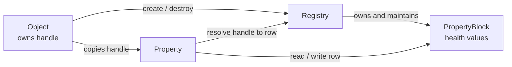

# Object and property storage: system design

## Goal and vocabulary

Give a user ordinary C++ syntax (`Player p; p.health = 100;`) while storing each
property in a contiguous, per-property block. This document describes the target
design and the work split for two implementers. The existing `dod.hpp` is a
working reference; this design uses the names in the sketch.

| Sketch name | Responsibility | Current code |
| --- | --- | --- |
| `Object` | Own a live entity's slot and generation; create, move, and destroy that entity | `Object<Derived>` stores an `EntityHandle` containing the two fields |
| `Property` | Present one named member and resolve its owner's value on access | `Property<Owner, T, Tag>` |
| `Registry` | Map stable slots to current dense rows; coordinate all property blocks | `Registry<Owner, Capacity, Allocator>` |
| `IPropertyBlock` | Let the registry append and remove rows without knowing a property's value type | `IColumn` |
| `PropertyBlock<T>` | Own contiguous values for one property | `Column<T, Capacity, Allocator>` |

Keep `EntityHandle { slot, generation }` as an **internal value type**, not as
another owner. Logically, these are the two fields in the sketch's `Object` box.
`Object` stores one handle; each `Property` stores a copy. A handle alone does
not create, keep alive, or destroy an entity.

For this version, every declared property has the defined default `T{}`. Thus
property types must be default constructible. Explicit custom defaults are a
separate API decision and are not required for this implementation.

```cpp
class Player : public dod::Object<Player> {
public:
    DOD_PROPERTY(int, health);   // default int{} == 0
    DOD_PROPERTY(float, speed);  // default float{} == 0.0f
};

{
    Player p;
    p.health = 100;
} // p is destroyed automatically here
```

`delete p` is invalid for the stack object above. To destroy explicitly, use
`auto p = std::make_unique<Player>(); p.reset();` (or pair `new` with `delete`).

## Component contracts

| Component | Owns | Main operations |
| --- | --- | --- |
| `Object<Owner>` | The lifetime of one registry entity and its handle | Constructor calls `Registry::create`; destructor calls `destroy`; move transfers ownership; `dod_handle()` returns a copy |
| `Property<Owner, T, Tag>` | A copy of the owner's handle; a shared, non-owning pointer to its typed block | `set`, `get`, `ref`, conversion and compound operators; asks the registry to resolve the handle on every access |
| `Registry<Owner, Capacity, Allocator>` | Slot table, generation counters, free slots, dense-to-slot mapping, and the list/map of blocks | `create`, `destroy`, `dense_index`, `block<Tag, T>`, `size`, `is_alive`, `view` |
| `IPropertyBlock` | No values directly; polymorphic structural interface | `append_default`, `swap_and_pop`, `rollback_last`, `size` |
| `PropertyBlock<T>` | One fixed-capacity contiguous allocation and its constructed `T` values | Typed indexing plus the `IPropertyBlock` operations |

There is one `Registry` per owner type, such as `Player`. Each declaration gets
a distinct `Tag`, so `health` and `age` have separate blocks even when both use
`int`. The registry identifies a block by tag; the property caches a pointer
to its typed block. `block<Tag, T>()` does not take an entity handle.



### Invariants

1. Each live slot maps to exactly one dense row, and that row maps back to the
   same slot. The handle generation must match the slot generation.
2. Every registered property block has exactly `Registry::size()` constructed
   values, in the same row order.
3. A property's stored handle identifies its owner. It never stores a lasting
   pointer or reference to a row, because rows can move on deletion.
4. `Object` is the sole lifetime owner. Moving it transfers the live entity;
   destroying a moved-from object does not destroy that entity twice.
5. This design is single-threaded. References and views must not be retained
   across entity creation, destruction, or another structural mutation.

## Logic flows

### F1 — Construct the first `Player`

Assume no `Player` registry or view has been used yet.

1. C++ constructs the `Object<Player>` base before `Player`'s members.
2. `Object` calls `Registry<Player>::create()`. First use constructs the
   registry, which allocates its fixed-capacity slot table and reserves its
   mapping/free-slot arrays.
3. `create()` chooses a slot, adds a dense row, records the slot-to-row mapping,
   and **returns** `{slot, generation}`. `Object` stores it. No blocks exist yet,
   so there are no property values to append at this moment.
4. C++ constructs `p.health`. The `DOD_PROPERTY` declaration gives it a copy
   of `p.dod_handle()`. Its constructor requests `block<health_tag, int>()`.
5. The registry has no health block, so it creates one, allocates space for
   `Capacity` integers, and default-constructs one value for the already-live
   `Player`. It records the block by tag.
6. Each later declared property follows step 4–5 in declaration order.

Allocation and construction differ: a block reserves room for `Capacity`
values immediately, but only the rows for live entities contain constructed
values. A call to `Player::view<&Player::health>()` before any `Player` can also
register the health block early, initially with zero constructed values.

### F2 — Construct another `Player`

1. `Object` calls `Registry::create()` again. The registry selects a slot.
2. The registry calls `append_default()` on **every existing block** before
   committing the new row. Each block constructs one `T{}` value.
3. The registry returns the new handle. The new `Player`'s properties copy that
   handle and find their already-registered blocks.
4. If a default constructor throws, the registry removes any values appended
   earlier in this attempt and leaves the live entity count unchanged.

### F3 — Set or read `p.health`

```text
p.health = 100
  -> Property::operator=(100)
  -> Property::set(100)
  -> Property::ref()
  -> Registry::dense_index(property's {slot, generation})
  -> health PropertyBlock[current dense row]
  -> write 100
```

For a read, `get()`/`const_ref()` follows the same lookup and returns the value
or a reference. `dense_index()` validates the generation when handle checks are
enabled. The property's handle is **passed to the registry on access**; it is
not passed during block registration.

### F4 — Destroy an object

1. C++ destroys the `Player` members, then its `Object<Player>` base.
2. `Object::~Object()` passes its handle to `Registry::destroy(handle)`.
3. The registry validates the handle and finds its current dense row.
4. If it is not the last row, each block moves its last value into the removed
   row. The registry updates the moved entity's slot-to-row mapping. Its handle
   remains unchanged.
5. Each block destroys its last value; the registry removes its last row,
   increments the removed slot's generation, and puts that slot on the free
   list. An old handle to this object is now stale.
6. A later object may reuse the slot with the **new generation**.

## Two-person implementation plan

Agree on the signatures below before editing in parallel. Keep the library
header-only and retain `#include <dod/dod.hpp>` as the public entry point.
Split the current single header so each person owns separate files; `dod.hpp`
becomes the umbrella header.

### Shared seam

Person B supplies `EntityHandle` and these `Registry` operations for Person A:

```cpp
EntityHandle create();
void destroy(EntityHandle) noexcept;
std::size_t dense_index(EntityHandle) const;
template<class Tag, class T>
PropertyBlock<T, Capacity, Allocator>& block();
template<class Tag, class T> std::span<T> view();
std::size_t size() const noexcept;
bool is_alive(EntityHandle) const noexcept;
```

Preserve the existing debug/release handle-check behavior unless the team
explicitly changes that contract.

### Person A — public object and property API

Own `object.hpp`, `property.hpp`, the `DOD_PROPERTY` macro, and umbrella
`dod.hpp`.

1. Define `Object<Owner>` construction, destruction, handle access, and
   non-copyable/movable ownership rules.
2. Define `Property<Owner, T, Tag>` with a copied handle and shared typed-block
   pointer. Connect the macro-generated member to `Object::dod_handle()`.
3. Implement property assignment, reads, `ref`, `const_ref`, `operator->`, and
   compound operators through `Registry::dense_index`.
4. Implement public `view`, `each`, `size`, and `is_alive` wrappers.
5. Add public-API tests in a separate test file. Do not edit Person B's storage
   files.

### Person B — registry and property storage

Own `entity_handle.hpp`, `registry.hpp`, `property_block.hpp` (including
`IPropertyBlock`), and the common test build wiring.

1. Implement the slot table, generation counters, free list, dense mapping,
   capacity limit, and registry singleton per owner type.
2. Implement typed block allocation, `T{}` row construction, typed indexing,
   row destruction, and correct alignment/destruction for nontrivial `T`.
3. Implement tag-to-block lookup and late registration that fills one default
   value per already-live entity.
4. Implement atomic `create` behavior: append to all blocks or roll back every
   successful append if a default constructor throws.
5. Implement `destroy` with swap-and-pop across all blocks and update the
   moved slot's dense index. Add storage tests in a separate test file.

### Integration order

1. Agree on the shared seam and compile a minimal `Player` declaration.
2. Merge the storage headers and public headers; wire separate test files into
   CMake without concurrent edits to the same build file.
3. Run the flow tests below in both handle-check modes. Fix contract mismatches
   before adding optimizations.

## Test flows and expected results

| ID | Owner | Setup and action | Expected result |
| --- | --- | --- | --- |
| T1 | B | Create the first entity, then register its first block | Block has one `T{}` value; block size equals registry size |
| T2 | B | Register a block after several entities already exist (including through `view`) | One default value per existing entity, in dense-row order |
| T3 | A + B | Create two `Player`s; assign different health values | Both read back correctly; changing one does not change the other |
| T4 | A + B | Declare `health` and `age` as `int`; write both | Values live in distinct blocks despite equal types |
| T5 | A | Set, get, use `ref`, `operator->`, and compound assignment | Each operation reaches the correct value and obeys its value type |
| T6 | B | Destroy the last row | All block sizes and registry size decrease by one; value destructor runs once |
| T7 | B + A | Destroy the middle of three entities | Last row moves into the gap; both survivors retain their values and handles |
| T8 | B + A | Destroy an entity, then reuse its slot | New handle has a different generation; old handle is stale; checked access rejects it |
| T9 | A | Move-construct and move-assign objects | Ownership and property access transfer; moved-from object cannot destroy the entity |
| T10 | B | Fill capacity, then attempt one more create | `length_error`; existing entities and blocks remain unchanged |
| T11 | B | Make a later block's default constructor throw during create | Earlier appended defaults are rolled back; all block sizes still match registry size |
| T12 | B | Store `std::string` and an over-aligned type; create and destroy rows | Values survive moves, destruct exactly once, and meet alignment |
| T13 | A + B | Iterate one block with `view` and several with `each` | Same row order across blocks; edits appear in property reads |
| T14 | A + B | Create different owner types with the same property name | Registries, capacities, and values remain independent |

Do not retain a `ref()` result or `view()` span across creation or destruction
in tests or application code; that is outside the reference-lifetime contract.

The end-to-end acceptance example is: create two `Player`s, observe defaults,
assign different values, delete one while the other stays live, verify the
survivor's value, create a replacement, and verify slot reuse with a new
generation and default property values.
